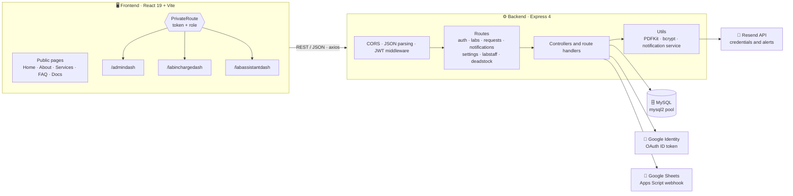
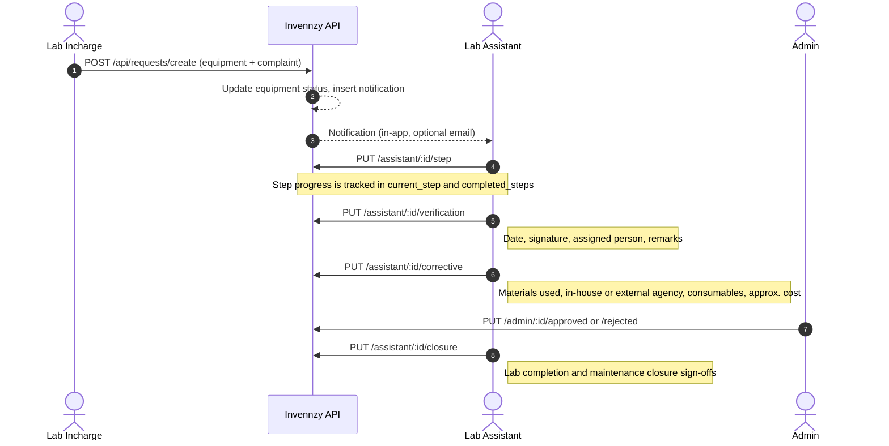
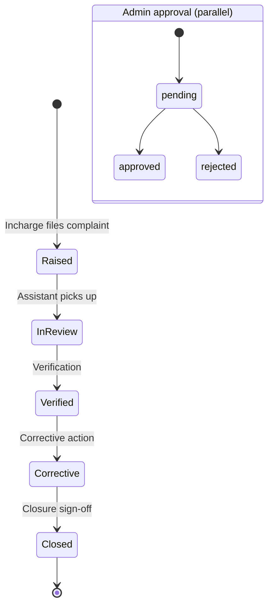
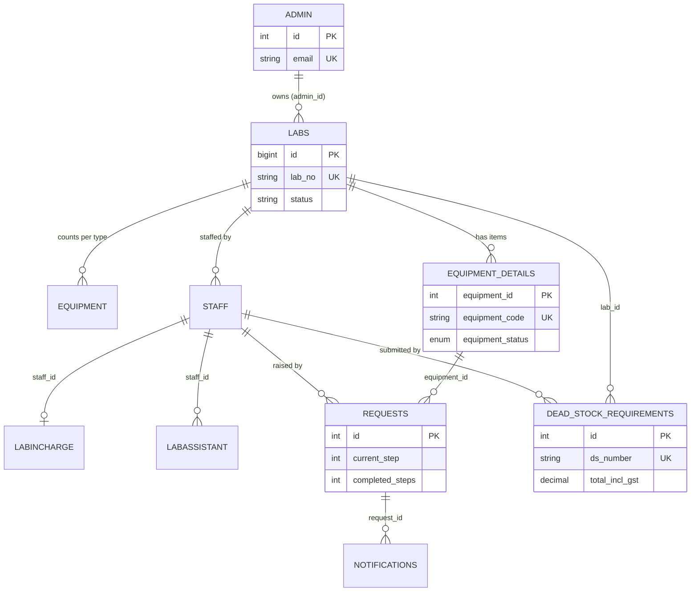

<div align="center">


# Invennzy

<a href="https://github.com/aniruddha9674/Invennzy">
  
</a>

<br/>


<p>
  <a href="#-overview">Overview</a> •
  <a href="#-features">Features</a> •
  <a href="#-architecture">Architecture</a> •
  <a href="#-request-workflow">Workflow</a> •
  <a href="#-tech-stack">Stack</a> •
  <a href="#-api-reference">API</a> •
  <a href="#-getting-started">Setup</a> •
  <a href="#-project-status">Status</a>
</p>

</div>

---

## 📖 Overview

**Invennzy** is a lab inventory and maintenance management system for colleges and institutions. Every lab, every piece of equipment and every fault report lives in one place, with a dashboard tailored to each person who touches it.

> [!NOTE]
> The repo is a monorepo with two apps: `InvennzyBackEnd/` (Express + MySQL REST API) and `InvennzyFrontEnd/` (React + Vite SPA).

| | |
|---|---|
| 🏫 **Lab-wise tracking** | Labs, buildings, floors, capacity and per-lab equipment counts |
| 🛠️ **Issue to resolution** | Maintenance requests move through a structured, signed-off workflow |
| 📦 **Dead stock** | Dead-stock requirement entries with GST maths and downloadable PDF reports |
| 👥 **Three roles** | Admin, Lab Incharge and Lab Assistant, each with its own dashboard |

---

## ✨ Features

<table>
<tr>
<td width="50%" valign="top">

### 🔐 Auth and accounts
- Email + password login with **bcrypt** hashing
- **Google Sign-In** with role matching
- **JWT** sessions (1 day expiry)
- Admin self-signup; Incharge and Assistant accounts are **provisioned automatically** when an admin creates a lab
- Random 8-character starter passwords, emailed via **Resend**

</td>
<td width="50%" valign="top">

### 🏫 Labs and equipment
- Create, edit and delete labs per admin
- Equipment records are **auto-generated** from the counts you enter (monitors, projectors, switch boards, fans, Wi-Fi, others)
- Unique equipment codes such as `monitor-3-1`
- Status per item: working, maintenance or damaged
- 3D equipment viewer built with Three.js

</td>
</tr>
<tr>
<td width="50%" valign="top">

### 🧾 Maintenance requests
- Incharge raises a complaint against a specific equipment item
- Assistant works the request through verification, corrective action and closure
- Admin approves or rejects
- Recurring-complaint tracking, external-agency and expenditure fields
- In-app notifications for every step

</td>
<td width="50%" valign="top">

### 📊 Reports and notifications
- Dead-stock requirement entry (PO no., DS number, unit rate, GST, totals)
- Single-item and full **PDF reports** generated server-side with PDFKit
- Per-user notification preferences (email, push, SMS flags)
- Profile photo upload and password change in settings
- Contact form piped to Google Sheets

</td>
</tr>
</table>

### 👥 Who can do what

| Capability | 🛡️ Admin | 🧑‍🏫 Lab Incharge | 🧑‍🔧 Lab Assistant |
|---|:---:|:---:|:---:|
| Create / edit / delete labs | ✅ | | |
| Provision Incharge and Assistant accounts | ✅ (via lab creation) | | |
| View inventory and equipment | ✅ | ✅ | ✅ |
| Update equipment details | | ✅ | ✅ |
| Raise a maintenance request | | ✅ | |
| Process a request (verify, fix, close) | | | ✅ |
| Approve or reject a request | ✅ | | |
| Submit dead-stock requirements | | | ✅ |
| Download dead-stock reports | ✅ | ✅ | ✅ |
| Reports and notifications | ✅ | ✅ | ✅ |

---

## 🏗️ Architecture



---

## 🔄 Request workflow

A maintenance request follows five steps. The Admin can approve or reject alongside.





> [!NOTE]
> The labels for steps 1 and 2 (*Raised*, *InReview*) are a plain-language summary of the `current_step` counter. Steps 3 to 5 map directly to the verification, corrective and closure endpoints.

---

## 🧰 Tech stack

<table>
<tr>
<th>Layer</th>
<th>Technology</th>
<th>Used for</th>
</tr>
<tr>
<td rowspan="5"><b>Frontend</b></td>
<td> </td>
<td>SPA, routing with React Router 7</td>
</tr>
<tr>
<td> </td>
<td>Styling and animation</td>
</tr>
<tr>
<td> </td>
<td>3D hero and equipment model (`logoinvennzy.glb`)</td>
</tr>
<tr>
<td> </td>
<td>API client and toasts</td>
</tr>
<tr>
<td>  </td>
<td>Client-side document and spreadsheet export libraries</td>
</tr>
<tr>
<td rowspan="4"><b>Backend</b></td>
<td> </td>
<td>REST API (CommonJS)</td>
</tr>
<tr>
<td> </td>
<td>Relational store, pooled connections, optional SSL CA</td>
</tr>
<tr>
<td>  </td>
<td>Auth: tokens, hashing, Google ID-token verification</td>
</tr>
<tr>
<td>  </td>
<td>PDF reports, photo uploads, transactional email</td>
</tr>
</table>

---

## 📁 Project structure

```text
Invennzy/
├── InvennzyBackEnd/
│   ├── src/
│   │   ├── server.js                  # Express app, route mounting, listen on :3000
│   │   ├── db.js                      # mysql2 pool (+ optional ca.pem SSL)
│   │   ├── controllers/auth/          # signup, login, forgot-password, google-signin
│   │   ├── middlewares/               # verifytoken.js (JWT), PhotoUploads.js (Multer)
│   │   ├── models/                    # Labs.js (lab + staff + account provisioning)
│   │   ├── routes/
│   │   │   ├── auth/                  # /api/auth
│   │   │   ├── Admin/                 # labs CRUD, admin reports and approvals
│   │   │   ├── Request/               # maintenance request workflow
│   │   │   ├── labinchargeassisstant/ # equipment, staff lookup, dead stock + PDFs
│   │   │   ├── Notification/          # per-role notification feed
│   │   │   ├── setting/               # profile, password, notification prefs
│   │   │   ├── Contactus/             # contact form → Google Sheets
│   │   │   └── LabStaff.js
│   │   └── utils/                     # Notification/, AccountCreation/ (email templates)
│   ├── Query.txt                      # SQL: tables + incremental ALTERs
│   └── migration_fix_staff_id.sql     # widens labassistant.staff_id to VARCHAR
└── InvennzyFrontEnd/
    ├── public/                        # logos, 3D model (logoinvennzy.glb)
    └── src/
        ├── App.jsx                    # route table
        ├── Pages/                     # public pages + 4 dashboard shells
        ├── components/
        │   ├── admincomponents/       # Admin dashboard views
        │   ├── Inchargecomponents/    # Lab Incharge views
        │   ├── Assistantcomponents/   # Lab Assistant views
        │   ├── SuperAdmin/            # Super-admin views (in progress)
        │   └── HeroSection · Features · LoginSection · Navbar · Footer
        └── Utils/                     # BackEnd.js (axios instance), PrivateRoute.jsx
```

---

## 🗄️ Data model



---

## 🔌 API reference

All routes are served under `/api`. Base URL in development: `http://localhost:3000`.

<details open>
<summary><b>🔑 Auth</b> · <code>/api/auth</code></summary>

| Method | Endpoint | Description |
|:---:|---|---|
| `POST` | `/signup` | Admin-only signup |
| `POST` | `/login` | Login for any role (`admin`, `labincharge`, `labassistant`) |
| `POST` | `/forgot-password` | Password-reset request |
| `POST` | `/google-signin` | Verify a Google ID token and log in |

</details>

<details>
<summary><b>🏫 Labs and equipment</b></summary>

| Method | Endpoint | Description |
|:---:|---|---|
| `GET` | `/api/labs/admin/:adminId` | Labs owned by an admin |
| `GET` | `/api/labs/:id` | Single lab |
| `POST` | `/api/labs` | Create lab, equipment rows and staff accounts |
| `PUT` | `/api/labs/:id` | Update lab |
| `DELETE` | `/api/labs/:id` | Delete lab |
| `GET` | `/api/labs/equipment/:adminId/:labId/:type` | Equipment of one type in a lab |
| `GET` | `/api/equipment` · `/api/equipment/:equipmentId` | List or fetch equipment |
| `PUT` | `/api/equipment/:equipmentId` | Update equipment details |
| `GET` | `/api/labstaff/incharge/:userId/lab` | Lab for a given incharge |

</details>

<details>
<summary><b>🧾 Maintenance requests</b> · <code>/api/requests</code></summary>

| Method | Endpoint | Description |
|:---:|---|---|
| `POST` | `/create` | Incharge raises a request |
| `GET` | `/lic/:staff_id` | Requests raised by an incharge |
| `GET` | `/assistant/:staff_id` | Requests assigned to an assistant |
| `GET` | `/:id` | Request detail |
| `PUT` | `/assistant/:id/step` | Advance step progress |
| `PUT` | `/assistant/:id/verification` | Verification details |
| `PUT` | `/assistant/:id/corrective` | Corrective action details |
| `PUT` | `/assistant/:id/closure` | Closure sign-offs |
| `PUT` | `/admin/:id/approved` · `/admin/:id/rejected` | Admin decision |

</details>

<details>
<summary><b>📦 Dead stock and reports</b></summary>

| Method | Endpoint | Description |
|:---:|---|---|
| `POST` | `/api/deadstock` | Submit a dead-stock requirement |
| `GET` | `/api/fetch/deadstock` · `/api/fetch/lab/deadstock` | List entries |
| `GET` | `/api/download/deadstock-report/:id` | PDF for one entry |
| `GET` | `/api/download/deadstock-full-report` | Full PDF report |
| `GET` | `/api/admin/reports` | Admin reports feed |

</details>

<details>
<summary><b>🔔 Notifications and settings</b></summary>

| Method | Endpoint | Description |
|:---:|---|---|
| `GET` | `/api/notifications/:role/:staff_id` | Notification feed |
| `PUT` | `/api/notifications/:id/read` | Mark as read |
| `DELETE` | `/api/notifications/:id` | Delete |
| `GET` | `/api/admin/notifications` · `/api/admin/notifications/pending/count` | Admin approval queue |
| `GET` `PUT` | `/api/settings/{admin,labincharge,labassistant}/profile` | Read or update profile (JWT) |
| `PUT` | `/api/settings/{admin,labincharge,labassistant}/password` | Change password |
| `GET` `PUT` | `/api/settings/{admin,labincharge,labassistant}/notifications` | Notification preferences |
| `POST` | `/api/googlesheet` | Contact-form submission |

</details>

---

## 🚀 Getting started

### Prerequisites


### 1 · Clone

```bash
git clone https://github.com/aniruddha9674/Invennzy.git
cd Invennzy
```

### 2 · Database

Create a database, then load the tables from [`InvennzyBackEnd/Query.txt`](InvennzyBackEnd/Query.txt).

```sql
CREATE DATABASE invennzy;
```

> [!IMPORTANT]
> `Query.txt` is a running log of CREATE and ALTER statements, not a single clean schema script. Run it statement by statement and watch for these:
> - A few `ALTER TABLE` blocks have a stray `;` in the middle of the column list (`admin`, `labincharge`, `labassistant`, `equipment_details` and `dead_stock_requirements`). Remove it so the statement continues.
> - Table names are used in lowercase by the code. On Linux, create `admin`, `labincharge` and `labassistant` in lowercase (the file starts with `Admin`, `LabIncharge`, `LabAssistant`).
> - Run [`migration_fix_staff_id.sql`](InvennzyBackEnd/migration_fix_staff_id.sql) as well.
> - The code also reads `requests.admin_approval_status` (`pending`, `approved`, `rejected`) and writes `notifications.staff_id`. Neither column is in `Query.txt`, so add them yourself.

### 3 · Backend

```bash
cd InvennzyBackEnd
npm install
npm install body-parser     # required by server.js, not listed in package.json
```

Create `InvennzyBackEnd/.env`:

```env
# Database
DB_HOST=localhost
DB_PORT=3306
DB_USER=root
DB_PASSWORD=your_mysql_password
DB_NAME=invennzy
# DB_SSL_CA=/path/to/ca.pem      # optional, for managed MySQL

# Auth
JWT_SECRET=use_a_long_random_string
GOOGLE_CLIENT_ID=your_google_oauth_client_id

# Email (Resend)
RESEND_API_KEY=re_xxxxxxxxx
```

```bash
npm run dev      # nodemon → http://localhost:3000
```

> [!IMPORTANT]
> Always set `DB_PASSWORD` and `JWT_SECRET` explicitly. The code has development fallbacks for both, which you should never rely on outside local testing.

### 4 · Frontend

```bash
cd ../InvennzyFrontEnd
npm install
```

Create `InvennzyFrontEnd/.env`:

```env
VITE_API_URL=http://localhost:3000
VITE_GOOGLE_CLIENT_ID=your_google_oauth_client_id
```

```bash
npm run dev      # Vite dev server → http://localhost:5173
```

> [!NOTE]
> `src/Utils/BackEnd.js` (reads `VITE_API_URL`) is the axios instance the app actually uses. `src/Utils/config.js` reads a different variable, `VITE_BACKEND_URL`, and nothing imports it.

### 5 · First run

1. Sign up as an **Admin** from the login section on the home page.
2. Open **Admin dashboard → Inventory** and create a lab with the incharge and assistant details.
3. Starter credentials for both are emailed through Resend. Log in as each role to try the workflow end to end.

---

## 📊 Project status

| Area | Status |
|---|:---:|
| Email/password auth, Google Sign-In, JWT | ✅ Working |
| Lab CRUD with auto-generated equipment and staff accounts | ✅ Working |
| Maintenance request workflow (create → verify → fix → close) | ✅ Working |
| Admin approve / reject | ✅ Working |
| Dead stock entry and PDF reports | ✅ Working |
| Settings: profile photo, password, notification preferences | ✅ Working |
| Email notifications | ⚠️ Implemented, verify against your schema (the service queries `lab`, `staffid` and `lab_id`, which differ from the table and column names in `Query.txt`) |
| Forgot password | 🚧 Endpoint checks the account but does not send a reset link yet |
| Super Admin portal | 🚧 UI only. The backend has no `/api/auth/superadmin/*` routes, and `App.jsx` imports `SuperAdmin/LabList.jsx`, which is not in the repo, so add or remove that import before `npm run dev` or `npm run build` will succeed |
| Automated tests | ❌ None yet |

### 🗺️ Roadmap

- [x] Role-based dashboards for Admin, Incharge and Assistant
- [x] Maintenance workflow with sign-off fields
- [x] Dead-stock reports as PDF
- [ ] Add `LabList.jsx` or remove the unused import
- [ ] Apply `verifyToken` and per-role checks to every API route (today it guards the settings routes)
- [ ] Reset-password email flow
- [ ] Super Admin backend
- [ ] Single clean `schema.sql` plus a `.env.example` for each app
- [ ] Unit and integration tests

---

## 🤝 Contributing

1. Fork the repo and create a branch: `git checkout -b feature/your-feature`
2. Commit your changes: `git commit -m "feat: describe your change"`
3. Push and open a pull request

<div align="center">

<br/>

**⭐ If this project is useful, consider giving it a star.**

</div>
